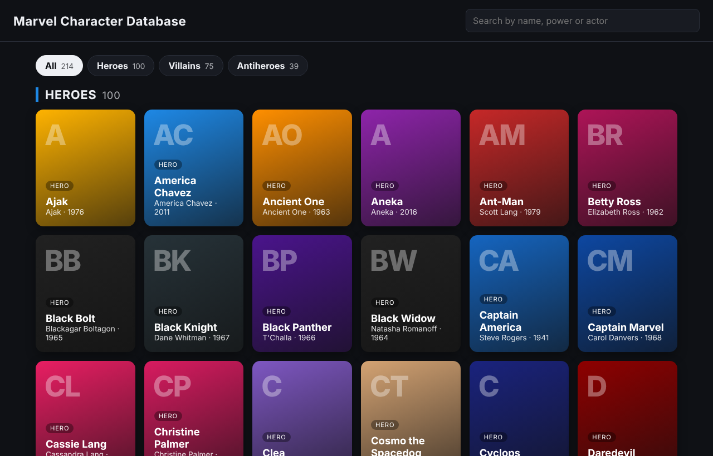
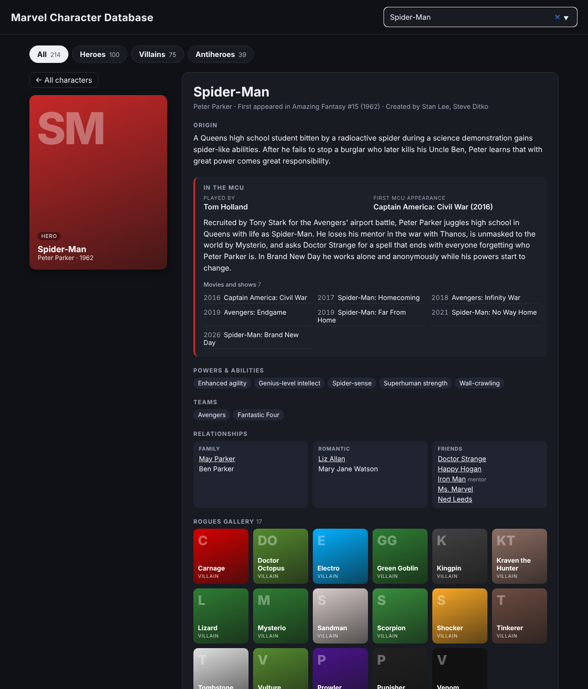

# Marvel Character Database

**▶ [Live demo](https://theoyanvno.github.io/marvel-character-database/)**

A Python + SQL web app for exploring 214 Marvel characters (100 heroes, 75 villains and 39 antiheroes), grouped into **Heroes**, **Villains** and **Antiheroes**. Type a name, real name, power or actor (try "flight" or "Hiddleston"), switch between sections, or click a card. It includes every comic character with a real role in a Marvel Cinematic Universe film or Disney+ series, from Iron Man (2008) through Spider-Man: Brand New Day and Wonder Man (2026), plus classic characters from the comics. The selected card slides to the side and the character's profile appears next to it:

- **In the MCU:** who plays them, their first MCU appearance, a short summary of their story across the movies and shows, and every title they're in
- **Origin, powers and teams** from the comics
- **Relationships** grouped into family, romantic and friends (allies for villains)
- **Rogues gallery:** a hero's enemies as small cards you can click through (villains show the heroes they fight)
- A timeline of pop culture highlights

Every card has a **photo slot** on its front. Add an image file and one line to the character's data, and the photo fills the card and the profile, with a credit underneath; characters without one keep their color card with initials. See [Card photos](#card-photos).

**Tech:** Python · Flask · SQLite (`sqlite3`) · SQL · vanilla JavaScript · CSS animations · `unittest`

| Card grid | Character profile |
|---|---|
|  |  |

## Database design

Nine related tables ([`sql/schema.sql`](sql/schema.sql)):

```
characters ──< character_powers >── powers
     │    ├──< character_teams  >── teams
     │    └──< mcu_roles        >── mcu_titles   (61 MCU movies and series, in release order)
     ├──< relationships  (family / friend / romantic / enemy; related_id links back to characters)
     └──< appearances    (comic, film, TV, animation; year and notes)
```

- **Many-to-many** relationships through link tables (`character_powers`, `character_teams`) with composite primary keys
- **Foreign keys**, `CHECK` constraints (alignment, relationship kind, medium), `UNIQUE` names and indexes
- Data loads from [`data/characters.json`](data/characters.json) and [`data/mcu_titles.json`](data/mcu_titles.json) in a single transaction, then an `UPDATE` with subqueries links relationships to characters in the database, by hero name or by real name when exactly one character has it
- Each relationship pair is stored once; the profile query shows it on both characters' pages

## SQL highlights

The app's queries live in [`sql/app_queries.sql`](sql/app_queries.sql), loaded by [`app/db.py`](app/db.py), and use parameterized statements (`?`) to prevent SQL injection. More to explore in [`sql/queries.sql`](sql/queries.sql):

- Search across three tables (names, powers, MCU actor) with `EXISTS` + `LIKE`, ranked with `ORDER BY CASE` so names that start with the search come first
- Relationships from both sides with `UNION` and `NOT EXISTS`, flipping "mentor" to "protégé" with a `CASE` when seen from the other side
- First MCU appearance by sorting each character's titles with `COALESCE(season year, title year)`
- Biggest rogues galleries with `COUNT(DISTINCT …)` over enemy pairs stored on either side
- Powers shared by several characters with `GROUP BY`, `HAVING` and `GROUP_CONCAT`
- Characters on no team with `LEFT JOIN … IS NULL`
- Rivalries where both characters are in the database (joining `characters` twice)
- Years between a character's comic debut and first film with a correlated subquery
- Search plus an optional side filter in one query: `HAVING (? = '' OR alignment = ?)`, where an empty side means everyone
- Debuts per decade with integer math in `GROUP BY`

## API

| Method | Endpoint | Returns |
|---|---|---|
| GET | `/api/characters?q=text` | Matching cards (name, real name, power or MCU actor) |
| GET | `/api/characters/<id>` | Full profile, or 404 |
| GET | `/api/characters?side=villain` | Only heroes, villains or antiheroes (combine with `q`) |
| GET | `/api/sides` | How many characters are on each side |
| GET | `/api/stats` | Counts by alignment, most common powers, debuts per decade, most MCU appearances, biggest rogues galleries |

## Live demo: the same SQL in the browser

GitHub Pages can only host static files, so it can't run the Flask server. The live demo still runs real SQL:

1. [`build_site.py`](build_site.py) builds the SQLite database file with the same Python code the app uses and writes the site to `docs/`.
2. In the browser, [`static-api.js`](app/static/static-api.js) downloads that database and runs it with [sql.js](https://sql.js.org) (SQLite compiled to WebAssembly).
3. Both the Flask app and the browser load their queries from the same file, [`sql/app_queries.sql`](sql/app_queries.sql), so the live demo runs exactly the same SQL as the server.

The front end calls one small data layer (`api.cards()`, `api.sides()`, `api.character()`), so it doesn't need to know which version it's talking to.

## Run it

```bash
python -m venv .venv && source .venv/bin/activate   # Windows: .venv\Scripts\activate
pip install -r requirements.txt
python -m app.main                                  # http://localhost:5000
python -m unittest discover -s tests -t .           # 21 tests
python build_db.py                                  # optional: writes marvel.db to explore in DB Browser for SQLite
python build_site.py                                # rebuilds the live demo in docs/
```

## Add a character

Add an entry to `data/characters.json` (same fields as the others) and restart the app. The database is rebuilt from the JSON file on startup. Run `python build_site.py` to update the live demo.

## Card photos

1. Put the image in [`app/static/images/`](app/static/images) (`.jpg`, `.png` or `.webp`, portrait works best).
2. In `data/characters.json`, add `"image": "spider-man.jpg"` to the character, and optionally `"image_credit": "Photo by …"`.
3. Run `python build_site.py` to update the live demo.

Building the database checks that each `image` is a plain file name with an allowed extension and that the file exists, so a typo stops the build with the character's name instead of showing a broken picture. The search and profile queries return the file name; the front end shows it as the card background with a fade into the card color behind the name. More in [`app/static/images/README.md`](app/static/images/README.md).

## Notes

- Each character's first comic appearance and creators come from the comics; for characters the films changed (for example Whiplash, Taskmaster or Ghost), the origin explains how the MCU version differs.
- The MCU section covers live-action films and series through October 2026, including the Netflix Defenders shows, which Marvel's official timeline counts as MCU. Characters who haven't appeared yet (like Storm or Magneto) say so. Sony's Venom, Morbius and Kraven films and Fox's X-Men films aren't counted, except where those characters crossed into MCU releases such as No Way Home and Deadpool & Wolverine.
- Unofficial fan project for learning Python and SQL. Not affiliated with or endorsed by Marvel. Character summaries are written in my own words. Cards show initials until a photo is added; any photo added must be one the owner of this repo has the right to publish, credited on the profile.
- Built with help from AI coding tools for planning, code review and tests.
